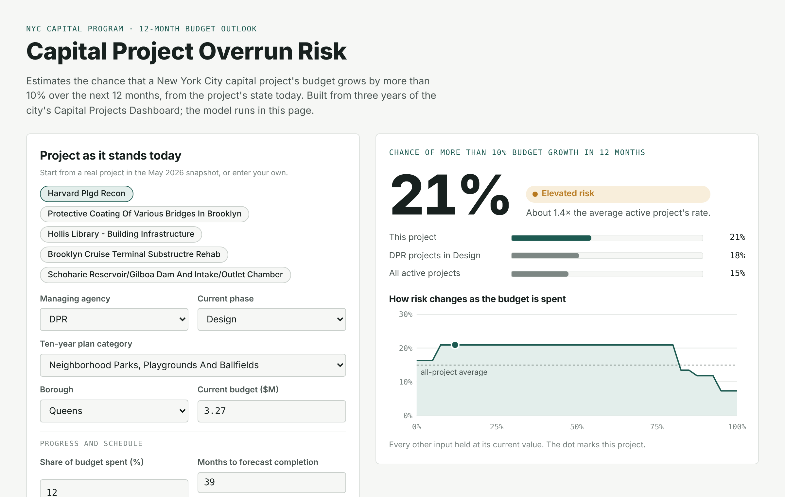
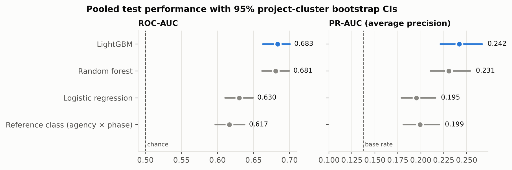
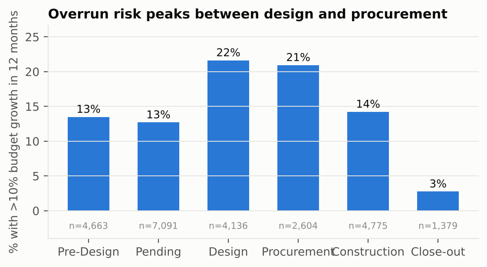
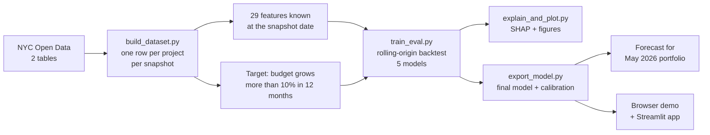
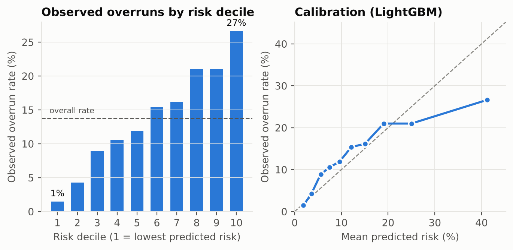
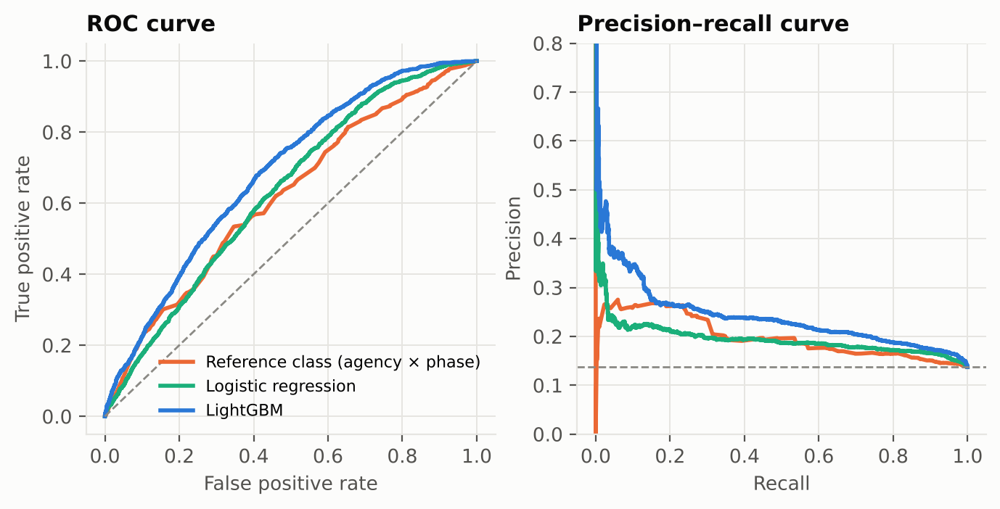
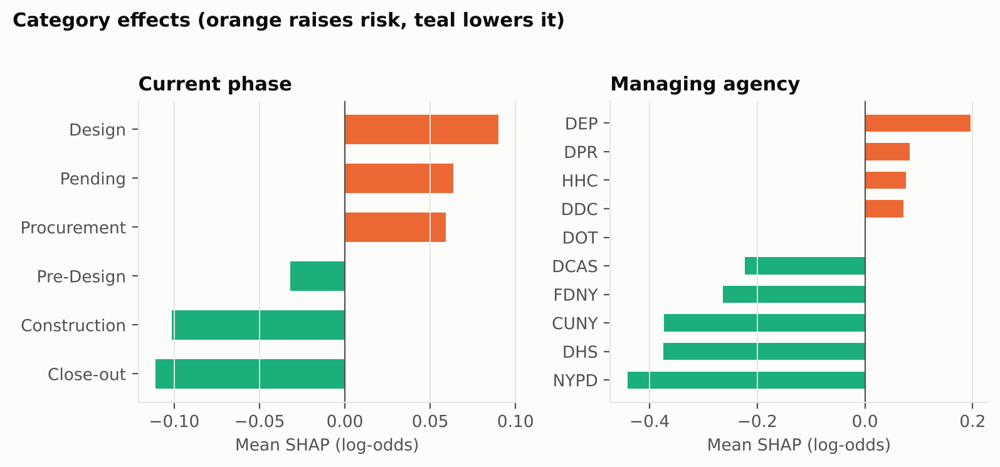

# Predicting Budget Overruns in NYC Capital Projects

  

Which live public construction projects are likely to need more money soon?

This project uses three years of New York City's public capital project data to estimate, for every active project, the probability that its budget grows by more than 10% over the next 12 months. It is built the way a cost manager would actually use it: a ranked watch-list, scored from each project's state today, and tested only on dates the model has never seen.

**[Try the live demo](https://lordlughas.github.io/Nyc-capital-overrun/demo/overrun-risk.html)** (the model runs entirely in your browser)

[](https://lordlughas.github.io/Nyc-capital-overrun/demo/overrun-risk.html)

---

## Contents

- [Results at a glance](#results-at-a-glance)
- [Why this question](#why-this-question)
- [The data](#the-data)
- [How it works](#how-it-works)
- [Results in detail](#results-in-detail)
- [What drives overrun risk](#what-drives-overrun-risk)
- [A forecast you can check](#a-forecast-you-can-check)
- [What I learned](#what-i-learned)
- [Limitations](#limitations)
- [Run it yourself](#run-it-yourself)
- [Repository layout](#repository-layout)
- [Next steps](#next-steps)
- [References](#references)

---

## Results at a glance

Tested on 11,008 project-snapshots from three later reporting dates (Sep 2024, Jan 2025, May 2025), using only information available at each date:

| Model | ROC-AUC (95% CI) | PR-AUC (95% CI) | Brier | Overrun rate in model's top 10% |
| --- | --- | --- | --- | --- |
| Constant (base rate) | 0.517 | 0.141 | 0.119 | 11.1% |
| Reference class (agency × phase) | 0.617 (0.597 to 0.638) | 0.199 (0.181 to 0.220) | 0.118 | 26.2% |
| Logistic regression | 0.630 (0.611 to 0.649) | 0.195 (0.179 to 0.216) | 0.121 | 21.9% |
| Random forest | 0.681 (0.662 to 0.699) | 0.231 (0.211 to 0.254) | 0.113 | 26.6% |
| **LightGBM (chosen)** | **0.683 (0.663 to 0.701)** | **0.242 (0.221 to 0.267)** | 0.115 | **26.6%** |

In plain terms:

- The test-set overrun rate is 13.7%. Among the 10% of projects the model rates riskiest, 26.6% overran: about **2× the average**.
- Among the 10% it rates safest, only **1.5%** overran.
- Both tree models beat the **reference-class baseline**, the standard technique from the cost-overrun literature, and their confidence intervals do not overlap with it.
- The scores are a **ranking tool, not a precise predictor**. A ROC-AUC of 0.68 means the model orders projects usefully, not that it can say for certain which will overrun.



---

## Why this question

Cost overrun on public works is one of the most studied problems in construction management. Flyvbjerg and colleagues found overruns in nine out of ten transport infrastructure projects across 20 countries, and traced much of the gap to **optimism bias** in early estimates. Their remedy, **reference class forecasting**, adjusts a new project's estimate by the overrun history of similar past projects.

Most machine-learning studies of overruns ask a backward-looking question: given a finished project's attributes at approval, what was its final overrun? They often use small, private datasets of a few hundred projects.

An agency managing a live portfolio needs a different answer. On any given reporting date, **which of my thousands of active projects are likely to come back for more money within the year?** That is the question here. It has three practical advantages:

1. It uses information that changes as a project progresses (phase, spend, schedule slip, recent budget moves), the same signals a quantity surveyor watches on a cost report.
2. It can be tested honestly, by training on earlier dates and scoring later ones.
3. Its output is something an agency could act on: a ranked list to review before budget requests arrive.

I came to this from quantity surveying, where cost planning, variations and final accounts are daily work. The intuitions from that practice (estimates firm up as design develops; most budget movement happens before contracts are let) turned out to be visible in the data. See [What drives overrun risk](#what-drives-overrun-risk).

---

## The data

Two public tables from the [NYC Capital Projects Dashboard](https://www.nyc.gov/site/capitalprojects/index.page), published on NYC Open Data by the Mayor's Office of Operations:

| Table | What it holds | How I used it |
| --- | --- | --- |
| [Citywide Budget and Schedule](https://data.cityofnewyork.us/d/fb86-vt7u) (`fb86-vt7u`) | One row per project per reporting period, every four months, May 2023 to May 2026. Agency, phase, total budget, spend to date, schedule dates, borough, budget line, ten-year plan category. About 5,500 to 5,800 projects per snapshot. | The main panel: features and targets |
| [Budget Spend History and Variance](https://data.cityofnewyork.us/d/qj5n-h5qp) (`qj5n-h5qp`) | Budget snapshots per project going back to 2006 | Each project's budget track record **before** the reporting date |

After cleaning, the modelling table has **24,648 labelled project-snapshots from 5,205 projects**. Of these, 15.0% saw budget growth above 10% within 12 months.

**Inclusion rules.** A project-snapshot is included when the project is in an active phase (pre-design, pending, design, procurement, construction or close-out), has a budget of at least $250,000, and still appears with a positive budget 12 months later. Completed, cancelled, on-hold and pass-through-funding projects are excluded.

**How budget growth is distributed.** Most projects do not change in a typical year: the median 12-month change is exactly zero. The 90th percentile is +22%, and 5.1% of rows saw budgets *fall* by more than 10%.

Overrun rates differ sharply by phase:



| Phase | Rows | Overrun rate |
| --- | --- | --- |
| Pre-Design | 4,663 | 13.5% |
| Pending | 7,091 | 12.7% |
| **Design** | 4,136 | **21.6%** |
| **Procurement** | 2,604 | **20.9%** |
| Construction | 4,775 | 14.2% |
| Close-out | 1,379 | 2.8% |

---

## How it works



### 1. The target

For a project with budget *B* at snapshot *t*:

```
growth_12m = B(t + 12 months) / B(t) − 1
overrun    = 1 if growth_12m > 10%, else 0
```

The 10% threshold separates material growth from routine adjustments and follows common practice in overrun studies. A secondary regression task predicts the size of the change (the log ratio of the two budgets).

### 2. The features

All 29 features are known at the snapshot date. Nothing from the future leaks in.

| Group | Features | Why it might matter |
| --- | --- | --- |
| Identity | Managing agency, ten-year plan category, budget line prefix, borough | Agencies and programmes have different delivery and budgeting habits |
| Size and progress | Budget (log₁₀ $), share of budget spent, sub-project count, current phase | How firm the estimate is likely to be |
| Schedule | Months since design start, since construction start, in current phase; months to forecast completion; recent schedule slip | Delays and cost growth often travel together |
| Budget momentum | Budget and spend change over the last four months | Recent revisions may signal more to come |
| Track record | Growth since first budget record, months since first record, count of past revisions | Young estimates are the least reliable (optimism bias) |
| Project name | Keyword flags: reconstruction, new build, bridge, school, park, water/sewer, street, MEP (HVAC, roof, elevator), library, site/land | Rough work type, since the data has no formal work classification |

### 3. Validation: a rolling-origin backtest

A random train/test split would be wrong here, for two reasons. The same project appears in many snapshots, so a random split puts near-copies of a project on both sides. And conditions change over time, so testing on the past flatters the model.

Instead, each test date is scored by a model trained **only on outcomes that were already known on that date**:

| Test snapshot | Trained on base snapshots | Training rows | Test rows |
| --- | --- | --- | --- |
| Sep 2024 | May 2023, Sep 2023 | 6,596 | 3,339 |
| Jan 2025 | May 2023 to Jan 2024 | 10,175 | 3,344 |
| May 2025 | May 2023 to May 2024 | 13,640 | 4,325 |

(A May 2024 snapshot's 12-month outcome is only known in May 2025, so it can't be used to train a model that predicts in September 2024.)

### 4. Models

1. **Constant**: the training overrun rate for everyone. The floor.
2. **Reference class**: the overrun rate for the project's agency and phase, shrunk toward the agency average when the group is small. This is a simple, honest version of Flyvbjerg's reference class forecasting, and the baseline that matters.
3. **Logistic regression** with one-hot categories and scaled numeric features.
4. **Random forest**, 500 trees.
5. **LightGBM** gradient-boosted trees with native categorical handling. Number of boosting rounds chosen by cross-validation **grouped by project**.

### 5. Uncertainty, explanation, calibration

- **Confidence intervals** come from 500 bootstrap resamples of whole projects, not rows, because rows from the same project are correlated.
- **Explanations** are exact TreeSHAP values from LightGBM.
- **Calibration**: the raw model overstates risk at the top, so reported probabilities pass through an isotonic regression fitted on the backtest predictions.

---

## Results in detail

### Lift and calibration



Observed overrun rates rise steadily from the lowest-risk decile (1.5%) to the highest (26.6%). Predicted and observed rates agree closely up to the eighth decile. In the top decile the raw model predicts 41% while 27% actually overran. That overconfidence is why the demo and forecast report **calibrated** risk.

### ROC and precision-recall curves



### Stability over time

| Test snapshot | ROC-AUC | PR-AUC | Overrun rate in top 10% |
| --- | --- | --- | --- |
| Sep 2024 | 0.666 | 0.245 | 25.8% |
| Jan 2025 | 0.672 | 0.250 | 25.8% |
| May 2025 | 0.705 | 0.236 | 27.3% |

Ranking improved as more history became available for training.

### Where the model is weak

| Phase | Test rows | Overrun rate | ROC-AUC |
| --- | --- | --- | --- |
| Construction | 2,129 | 13.1% | 0.695 |
| Pending | 3,068 | 10.3% | 0.693 |
| Pre-Design | 1,935 | 14.1% | 0.683 |
| Close-out | 957 | 2.7% | 0.654 |
| Design | 1,916 | 21.1% | 0.627 |
| **Procurement** | 1,003 | 21.0% | **0.524** |

Inside the **procurement** phase the model is close to chance, even though those projects overrun often. Budget changes at that stage follow bid results, and tender prices are not in the public data. By agency, the model does best for CUNY (0.78), NYC Health + Hospitals (0.73) and the Department of Design and Construction (0.72), and worst for the Department of Environmental Protection (0.53), whose large water and sewer programmes behave differently from building projects.

### Predicting the size of the change

The regression model's mean absolute error on the log budget ratio (0.092) is **no better than predicting "no change" for every project** (0.092). It does rank the size of change moderately (Spearman 0.31). Because most projects don't change in a year, an average-error metric rewards predicting zero. Predicting *whether* material growth happens turned out to be the more learnable and more useful task.

---

## What drives overrun risk




Read from a cost manager's side of the table, the patterns are familiar:

| Driver | What the model learned | Construction interpretation |
| --- | --- | --- |
| **Share of budget spent** | Risk peaks at 5 to 30% spent and falls steeply above 60% | Early on, the estimate is provisional. Once most money is committed through contracts, there is little room left to move. |
| **Age of the estimate** | Projects whose first budget record is under ~2 years old carry the most risk | The optimism-bias story: young estimates are revised upward as scope is defined. |
| **Phase** | Design, pending and procurement raise risk; construction and close-out lower it | Design is when scope grows and when early estimates are replaced by designers' estimates. |
| **Schedule** | 0 to 50 months to forecast completion raises risk; overdue projects are lower | Overdue projects in this data mostly sit idle in the books rather than drawing new funds. |
| **Size** | Projects of about $1M to $3M carry more risk than very large ones | A fixed-sum addition is a bigger share of a small budget; large programmes may already hold contingency. |
| **Agency** | Environmental Protection, Parks, Health + Hospitals and Design and Construction push risk up; NYPD, Homeless Services, CUNY and FDNY pull it down | Different agencies budget and deliver differently. |

These are associations learned by the model, **not causal effects**. For example, the spend pattern could partly reflect agencies topping up budgets just before a contract award.

---

## A forecast you can check

[`results/forecast_2026-05_next12m.csv`](results/forecast_2026-05_next12m.csv) scores all **4,116 active projects** in the May 2026 snapshot. The model expects about **500** of them to see budget growth above 10% by May 2027.

The forecast was made before the outcomes exist. When the May 2027 snapshot is published, anyone can rerun `build_dataset.py` and check it. The eight highest-risk projects:

| Project | Agency | Phase | Budget | Spent | Risk |
| --- | --- | --- | --- | --- | --- |
| Bronx Aramark building elevator (X360-119M) | DPR | Construction | $0.74M | 74% | 55% |
| Jennie Clark Residence fire alarm upgrade | DDC | Construction | $3.32M | 30% | 50% |
| Non-standard installs, TA | DDC | Design | $8.07M | 23% | 43% |
| Tide gate on sewer at Avenue K, Brooklyn | DDC | Procurement | $1.94M | 25% | 43% |
| Allerton elevator replacement | DDC | Procurement | $3.14M | 22% | 43% |
| Non-standard pedestrian ramp installs, Brooklyn and Staten Island | DDC | Design | $8.56M | 15% | 43% |
| Blue Smoke, Hamilton | DOT | Pre-Design | $2.10M | 0% | 43% |
| Bushwick roof replacement | DDC | Construction | $2.82M | 15% | 43% |

Several projects share 43% because isotonic calibration maps a range of raw scores to one value.

---

## What I learned

The most useful lessons came from things that went wrong or turned out differently than expected.

### 1. Validation design mattered more than model choice

The jump from logistic regression to gradient boosting was worth about 0.05 ROC-AUC. The way I validated could easily have been worth more than that, in the wrong direction. A random split would have let the model see the same project at other dates during training, and tested it on a past it had already partly seen. The rolling-origin backtest is less flattering but tells the truth about how the model would perform on next year's portfolio.

### 2. Leakage can hide inside the inner loop, too

My first LightGBM version chose its number of boosting rounds by early-stopping on the most recent training snapshot. That looked sensible, but the same projects appeared in both the inner-train and inner-validation sets, so the validation score kept improving long after the model had started memorising projects. It stopped after **610 to 1,475 rounds**.

Switching to cross-validation **grouped by project** cut that to about **200 rounds** and improved every test metric:

| LightGBM version | ROC-AUC | PR-AUC | Brier (lower is better) |
| --- | --- | --- | --- |
| Inner validation on last snapshot | 0.679 | 0.238 | 0.121 |
| Inner CV grouped by project | **0.683** | **0.242** | **0.115** |

The Brier score is the clearest signal. The leaky version was not just slightly worse, it was badly calibrated: its Brier score was *worse than the constant model's* (0.119).

### 3. A good baseline is hard to beat, and worth respecting

The reference-class table (overrun rate by agency and phase) matches the best models on top-decile precision: 26.2% against 26.6%. If you can only review the riskiest 10% of projects, a simple lookup table does nearly as well as machine learning. Where the model earns its keep is the rest of the list. The reference class gives every project in the same agency and phase the same score, so it can't separate a young, unspent design project from one that is nearly finished. Knowing *where* a model adds value is more useful than a single headline number.

### 4. The loss function has to match the shape of the data

My first regression model used a Huber loss and scored a mean absolute error of 0.139, **much worse** than simply predicting "no change" (0.092). Most budgets don't move in a year, so the distribution has a huge spike at zero. Switching to an L1 (median) loss brought the error down to 0.092, matching the baseline but not beating it. The honest conclusion is that this data supports predicting whether growth happens, not by how much, and the report says so instead of hiding the result.

### 5. A high score is not a probability until it is calibrated

The model ranked well but was overconfident at the top: its top decile averaged a 41% predicted risk against 27% observed. For a watch-list the ranking alone is fine, but anyone reading "41%" next to a project would take it literally. Isotonic calibration on out-of-sample backtest predictions fixed the scale without changing the order.

### 6. Real public data needs careful reading before modelling

- **Repeated rows.** Some project IDs are split across several agency sub-projects that each repeat the full project budget. Summing them would have multiplied budgets several times over. I kept one row per project per date and checked the result against the separate history table: **99.6%** of budgets matched.
- **Placeholder dates.** Some schedule fields hold years like 1900 or 2999. These produced "projects" running for 1,400 months. I treated impossible spans as missing rather than dropping the rows.
- **Messy categories.** The phase field had about 60 different values (`(On-Hold)`, `(On-hold)`, `(On Hold)`, `CONSTRUCTION`...). Mapping them to six clean phases was necessary before any analysis.
- **Survivorship.** A project that is cancelled or merged disappears from later snapshots. Requiring a 12-month outcome quietly excludes those projects, and that bias belongs in the limitations rather than being ignored.

### 7. Confidence intervals need the right unit of resampling

A row-level bootstrap would treat 11,008 test rows as independent, when they come from far fewer projects observed repeatedly. Resampling whole projects gives wider, honest intervals. With them, I could say that LightGBM and the random forest are statistically tied, which a naive interval might have hidden.

### 8. Domain knowledge helps most in interpretation

Feature engineering from domain intuition (age of estimate, spend share, phase) helped, but the bigger payoff was in reading the results. The SHAP patterns line up with what a quantity surveyor would expect: risk concentrates where scope is still fluid and contracts are not yet let. That agreement makes the model more trustworthy, and the places where it disagrees (procurement, overdue projects) point to what the data is missing.

### 9. Shipping the model changes how you build it

To make a demo anyone can open without a server, I exported the 318 LightGBM trees to JSON and wrote a small JavaScript tree evaluator. I tested it against Python on 300 sample projects, most with missing values: the largest difference was **0.0000003**. The parts that need the most care are missing values and categorical splits, which LightGBM handles in specific ways that a hand-written evaluator has to copy exactly. Saving test vectors from Python and checking against them is what makes a port like this trustworthy.

### 10. Practical friction is part of the work

NYC Open Data refused downloads from Nigeria with a 403 error. The workaround was running the pipeline from a cloud environment. The README includes instructions for placing the CSVs manually, because a reproducible project has to survive its data source being awkward.

---

## Limitations

- **Budget growth is not identical to cost overrun.** Scope can be added on purpose, and funds can be moved between projects. The public data does not record why a budget changed.
- **Survivorship.** Projects that disappear within 12 months are excluded.
- **Short history.** Three years, one city, one administration, three test folds.
- **Missing cost drivers.** No bid prices, change orders or construction price indices, which explains the weakness in procurement.
- **Missing schedules.** About half of rows have no schedule dates, partly because the dashboard only publishes schedules for projects in design or later.
- **Approximate calibration.** Calibration was fitted on backtest predictions and applied to a model retrained on all data.
- **Repeat projects.** The same project can appear in training and testing at different dates. This mirrors real use, but the results say less about brand-new projects.

---

## Run it yourself

Requires Python 3.11 or later.

```bash
git clone https://github.com/lordlughas/Nyc-capital-overrun.git
cd Nyc-capital-overrun
pip install -r requirements.txt

python src/download.py          # ~20 MB from NYC Open Data
python src/build_dataset.py     # clean data, build features and targets
python src/train_eval.py        # rolling-origin backtest (~1 minute)
python src/explain_and_plot.py  # SHAP values and figures
python src/export_model.py      # final model, calibration, forecast
python demo/build_demo.py       # rebuild the browser demo (optional)

streamlit run app/streamlit_app.py   # interactive app with per-prediction SHAP
```

Every number in this README is reproduced by these commands from the raw data.

**If the download returns 403:** NYC Open Data blocks some countries. Download the two CSVs from a US connection ([table 1](https://data.cityofnewyork.us/api/views/fb86-vt7u/rows.csv?accessType=DOWNLOAD), [table 2](https://data.cityofnewyork.us/api/views/qj5n-h5qp/rows.csv?accessType=DOWNLOAD)) and save them in `data/raw/` as `fb86-vt7u.csv` and `qj5n-h5qp.csv`.

The browser demo needs no install: open `demo/overrun-risk.html` in any browser.

---

## Repository layout

```
src/
  download.py           fetch the two NYC Open Data tables
  build_dataset.py      clean data, build the project × snapshot table, features and targets
  train_eval.py         rolling-origin backtest of five models, bootstrap CIs, segment analysis
  explain_and_plot.py   SHAP values and all figures
  export_model.py       final model, isotonic calibration, May 2026 forecast, demo export
app/
  streamlit_app.py      interactive app with per-prediction SHAP explanations
demo/
  template.html         browser demo source
  build_demo.py         inlines the model into demo/overrun-risk.html
  predict.js            standalone LightGBM tree evaluator (tested against Python)
  overrun-risk.html     self-contained demo (built)
  model.json            exported trees and metadata
models/
  overrun_lgbm.txt      final LightGBM model
  model_meta.json       feature order, categories, calibration map
results/
  metrics.json          all backtest metrics
  figures/              charts used in this README
  risk_deciles.csv      observed vs predicted risk by decile
  shap_importance.csv   mean |SHAP| per feature
  forecast_2026-05_next12m.csv   scored May 2026 portfolio
docs/
  demo-screenshot.png
```

---

## Next steps

1. **Add cost-driver data.** Contract award values, change-order logs or construction price indices would target the procurement blind spot directly.
2. **Model time to the next budget change.** A survival model would use every snapshot instead of a fixed 12-month window, and would handle projects that drop out more cleanly.
3. **Test transfer across cities.** Training on New York and testing on another city's capital portfolio would show which drivers are general and which are local.
4. **Apply it where data is scarce.** The method only needs periodic snapshots of each project's budget, spend and phase, which most public works agencies already compile internally. In Nigeria, where public capital projects face similar overrun and abandonment problems, a pilot on one state's capital budget, with quantity surveyors labelling the reason for each budget revision, would test whether the same drivers hold and add the missing "why" behind each change.
5. **Check the May 2026 forecast** against the May 2027 snapshot when it is published.

---

## References

1. Flyvbjerg, B., Holm, M. S. and Buhl, S. (2002). Underestimating costs in public works projects: Error or lie? *Journal of the American Planning Association*, 68(3), 279–295.
2. Flyvbjerg, B. (2008). Curbing optimism bias and strategic misrepresentation in planning: Reference class forecasting in practice. *European Planning Studies*, 16(1), 3–21.
3. Ke, G. et al. (2017). LightGBM: A highly efficient gradient boosting decision tree. *Advances in Neural Information Processing Systems 30*.
4. Lundberg, S. M. and Lee, S.-I. (2017). A unified approach to interpreting model predictions. *Advances in Neural Information Processing Systems 30*.
5. Tashman, L. J. (2000). Out-of-sample tests of forecasting accuracy: An analysis and review. *International Journal of Forecasting*, 16(4), 437–450.
6. NYC Mayor's Office of Operations. Capital Projects Dashboard, NYC Open Data. Downloaded November 2026.

---

## Author

**Charles Lughas**. B.Tech Quantity Surveying (First Class Honours); backend software developer working in C#, ASP.NET Core, Oracle and Python. Interested in construction informatics and machine learning for infrastructure management.

Licensed under the [MIT License](LICENSE). The data is public and published by the City of New York.
