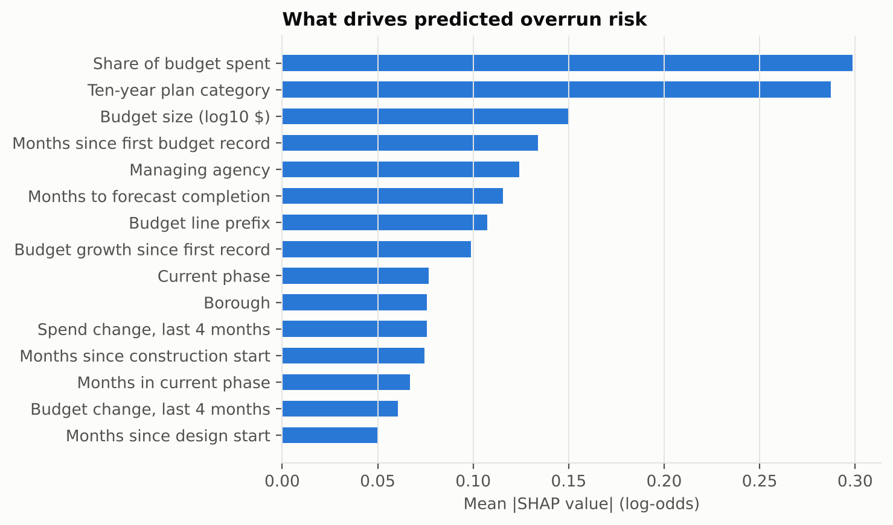
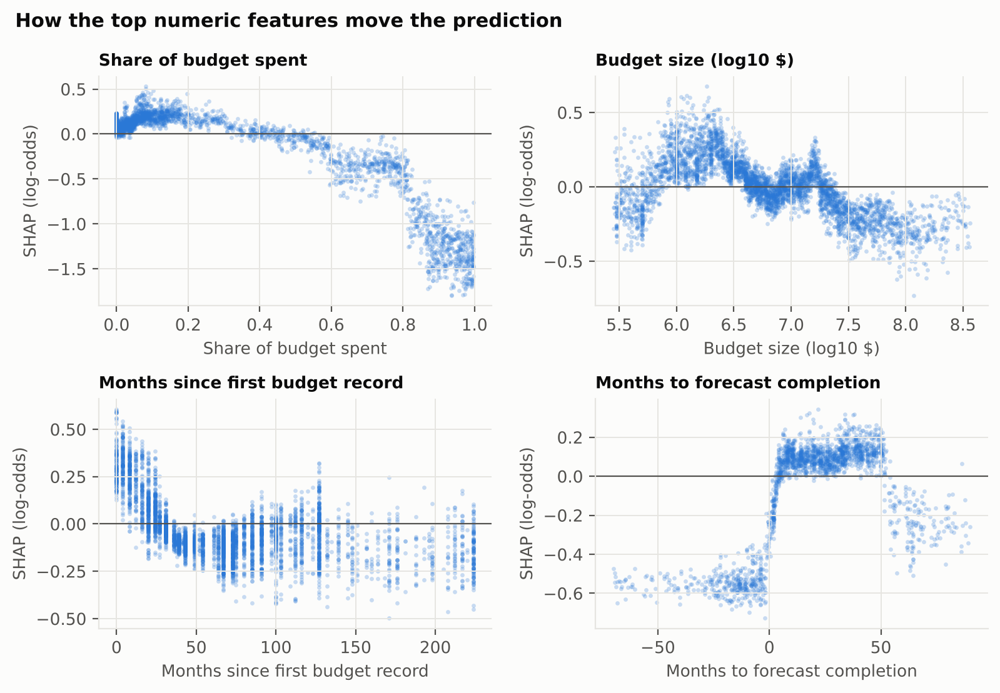

# Predicting Budget Overruns in NYC Capital Projects

Which active public construction projects are likely to need more money soon? This project trains a model on three years of New York City's Capital Projects Dashboard to estimate, for each active project, the chance that its budget grows by more than 10% over the next 12 months.

**Headline results** (rolling-origin backtest, 11,008 unseen project-snapshots):

| Model | ROC-AUC (95% CI) | PR-AUC | Overrun rate in top 10% |
| --- | --- | --- | --- |
| Constant (base rate) | 0.517 | 0.141 | 11.1% |
| Reference class (agency × phase) | 0.617 (0.597–0.638) | 0.199 | 26.2% |
| Logistic regression | 0.630 (0.611–0.649) | 0.195 | 21.9% |
| Random forest | 0.681 (0.662–0.699) | 0.231 | 26.6% |
| **LightGBM** | **0.683 (0.663–0.701)** | **0.242** | **26.6%** |

Projects in the model's top risk decile overran at 26.6%; those in the bottom decile at 1.5%.


## Why this framing

Most machine-learning studies of construction cost overrun predict the final overrun of finished projects from attributes fixed at approval. A portfolio owner needs something else: a ranked watch-list of live projects, refreshed as they progress. This project predicts 12-month budget growth from each project's state at a reporting date (phase, spend, schedule and budget track record), and tests that prediction only on later dates, as it would be used.

The baseline it has to beat is **reference class forecasting** (Flyvbjerg, 2008): the historical overrun rate of similar projects, here the same agency and phase.

## What drives the risk



- **Share of budget spent** is the strongest signal. Risk peaks when 5–30% is spent and falls steeply above 60%, once most money is committed through contracts.
- **Young estimates** (first budget record under about two years old) carry the most risk, consistent with optimism bias in early estimates.
- **Design and procurement** raise risk; construction and close-out lower it.
- The model is **weak inside the procurement phase** (ROC-AUC 0.52), where budget changes follow bid results that the public data does not include.



## Forward forecast

`results/forecast_2026-05_next12m.csv` scores all 4,116 active projects in the May 2026 snapshot. The model expects about 500 of them to see budget growth above 10% by May 2027. The forecast was made before those outcomes exist, so the May 2027 snapshot will test it.

## Data

Two public tables from the NYC Capital Projects Dashboard on NYC Open Data:

- [Citywide Budget and Schedule](https://data.cityofnewyork.us/d/fb86-vt7u) (fb86-vt7u): one row per project per four-monthly reporting period, May 2023 to May 2026.
- [Citywide Budget Spend History and Variance](https://data.cityofnewyork.us/d/qj5n-h5qp) (qj5n-h5qp): budget snapshots back to 2006, used for each project's budget track record.

The modelling table has 24,648 labelled project-snapshots from 5,205 projects; 15.0% saw budget growth above 10% within a year.

## Method in brief

- **Target**: budget 12 months later ÷ budget now − 1 > 10%.
- **Features** (29, all known at the reporting date): agency, ten-year plan category, budget line, borough, phase, budget size, share spent, schedule position and slip, recent budget and spend change, budget growth and revisions since first record, project-name keywords.
- **Validation**: rolling origin with three test snapshots (Sep 2024, Jan 2025, May 2025). Each model trains only on outcomes already known at the test date. LightGBM's boosting rounds are chosen by cross-validation grouped by project, so the same project is never on both sides of an inner split.
- **Uncertainty**: 95% intervals from 500 bootstrap resamples of whole projects.
- **Explanation**: exact TreeSHAP values from LightGBM.
- **Calibration**: the raw model is overconfident in its top decile, so reported risks are calibrated with isotonic regression on backtest predictions.

## Repository layout

```
src/
  download.py           fetch the two NYC Open Data tables
  build_dataset.py      clean, build the project × snapshot table and targets
  train_eval.py         rolling-origin backtest of five models
  explain_and_plot.py   SHAP values and figures
  export_model.py       final model, calibration, forward forecast, demo export
app/streamlit_app.py    interactive demo with per-prediction SHAP
demo/
  template.html         browser demo (model runs client-side in JavaScript)
  build_demo.py         inlines the model into demo/overrun-risk.html
  predict.js            standalone tree evaluator, tested against Python
results/                metrics.json, figures, risk deciles, forecast CSV
models/                 trained LightGBM model and metadata
```

## Reproduce

Python 3.11 or later.

```bash
pip install -r requirements.txt
python src/download.py          # ~20 MB from NYC Open Data
python src/build_dataset.py
python src/train_eval.py        # ~1 minute
python src/explain_and_plot.py
python src/export_model.py
python demo/build_demo.py       # optional: rebuild the browser demo
streamlit run app/streamlit_app.py
```

NYC Open Data blocks downloads from some countries. If `download.py` returns 403, download the two CSVs from a US connection and place them in `data/raw/` as `fb86-vt7u.csv` and `qj5n-h5qp.csv`.

## Limitations

- Budget growth is not identical to cost overrun: scope can be added on purpose, and the data does not record why a budget changed.
- Projects that disappear within 12 months are excluded, which may bias the sample.
- Three years of data from one city and one administration; three test folds.
- No bid, change-order or price-index data, which limits accuracy in procurement.

## References

1. Flyvbjerg, B., Holm, M. S. and Buhl, S. (2002). Underestimating costs in public works projects: Error or lie? *Journal of the American Planning Association*, 68(3), 279–295.
2. Flyvbjerg, B. (2008). Curbing optimism bias and strategic misrepresentation in planning: Reference class forecasting in practice. *European Planning Studies*, 16(1), 3–21.
3. Ke, G. et al. (2017). LightGBM: A highly efficient gradient boosting decision tree. *NeurIPS 30*.
4. Lundberg, S. M. and Lee, S.-I. (2017). A unified approach to interpreting model predictions. *NeurIPS 30*.
5. Tashman, L. J. (2000). Out-of-sample tests of forecasting accuracy: An analysis and review. *International Journal of Forecasting*, 16(4), 437–450.

## Author

Charles Lughas. B.Tech Quantity Surveying (First Class Honours); backend software developer. Built as a study in applying machine learning to construction cost management.
